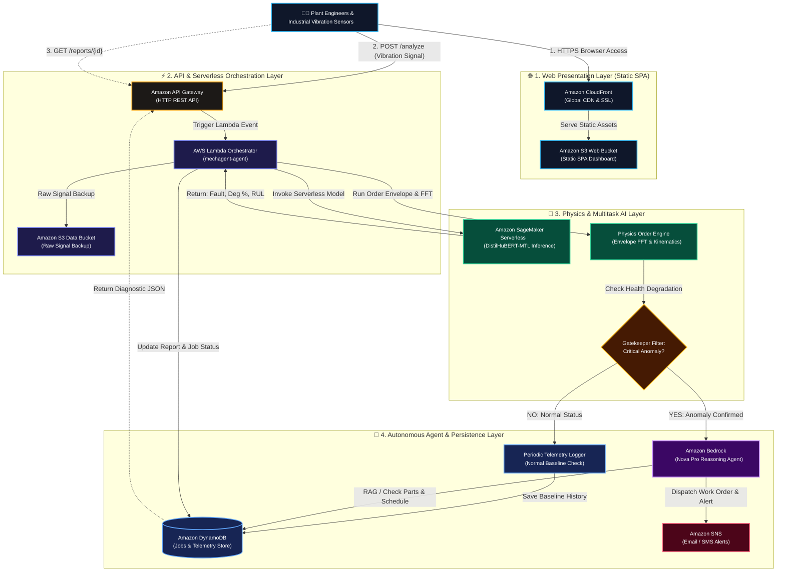

# 🏆 MechAgent: Physics-Informed Agentic Predictive Maintenance
> **โครงการนำเสนอสำหรับการแข่งขัน NTT DATA Hackathon**  
> **สถาปัตยกรรม:** 100% Serverless First บน Amazon Web Services (Region: `ap-southeast-1` Singapore)  
> **ลิงก์ระบบสด (CloudFront HTTPS):** [https://d38e5nijdx3gmh.cloudfront.net](https://d38e5nijdx3gmh.cloudfront.net)  
> **API Gateway Endpoint:** [https://jynfhl5nc9.execute-api.ap-southeast-1.amazonaws.com](https://jynfhl5nc9.execute-api.ap-southeast-1.amazonaws.com)  

---

## 1. Project Name & Tagline

* **ชื่อโปรเจกต์อย่างเป็นทางการ:** **MechAgent** (Physics-Informed Agentic Predictive Maintenance System)
* **Tagline:**  
  > *"เปลี่ยนข้อมูลการสั่นสะเทือนสู่การตัดสินใจซ่อมบำรุงที่แม่นยำ ไร้การคาดเดา ด้วยพลัง Physics-Informed MTL AI และสถาปัตยกรรม 100% Serverless บน AWS"*

---

## 2. Use Case & Pain Points

### กลุ่มเป้าหมาย (Target Users)
* โรงงานอุตสาหกรรมการผลิต (Manufacturing Plants), โรงไฟฟ้า, ระบบสาธารณูปโภค (Utilities)
* ผู้จัดการโรงงาน (Plant Managers), วิศวกรความน่าเชื่อถือ (Reliability Engineers) และช่างเทคนิคซ่อมบำรุง (Maintenance Technicians)

### ปัญหาสำคัญในปัจจุบัน (Current Pain Points)
1. **Unplanned Downtime มีมูลค่าความเสียหายมหาศาล:**  
   ตลับลูกปืน (Bearings) เป็นหัวใจสำคัญของเครื่องจักรหมุน (Rotary Equipment) เช่น ปั๊ม มอเตอร์ และพัดลมอุตสาหกรรม การชำรุดเฉียบพลัน (Catastrophic Failure) ทำให้สายการผลิตหยุดชะงัก มีค่าเสียหายเฉลี่ยสูงถึงหลายแสนบาทต่อชั่วโมง
2. **การซ่อมบำรุงตามรอบเวลา (Fixed-Schedule Preventive Maintenance) ไม่มีประสิทธิภาพ:**  
   การเปลี่ยนอะไหล่ตามรอบชั่วโมงทำงานทำให้เกิด Over-maintenance (ทิ้งอะไหล่ที่ยังใช้งานได้ดี) หรือ Under-maintenance (อะไหล่พังก่อนรอบซ่อม) สิ้นเปลืองงบประมาณ
3. **การพึ่งพาผู้เชี่ยวชาญเฉพาะทาง (Vibration Specialists Bottleneck):**  
   การวิเคราะห์กราฟสเปกตรัมความถี่การสั่นสะเทือน (FFT / Envelope Spectrum) ต้องใช้บุคลากรที่มีใบเซอร์ระดับสูง ซึ่งมีจำนวนน้อยและไม่สามารถเฝ้าระวังเครื่องจักรหลายร้อยตัวได้พร้อมกันแบบ 24/7
4. **ปัญหาของ AI ทั่วไป (Hallucination & Black-box Risk):**  
   โมเดล AI เชิงภาษา (LLM) ทั่วไปมักเกิดอาการ "หลอน" (Hallucination) เมื่อต้องคำนวณตัวเลขอายุคงเหลือ (RUL) ซึ่งเป็นอันตรายอย่างยิ่งต่อความปลอดภัยของโรงงาน

---

## 3. AWS Solution & Key Features

MechAgent ตอบโจทย์ด้วยการผสาน **Physics-Informed Multi-Task Learning (MTL) AI** เข้ากับสถาปัตยกรรม **100% Serverless บน AWS** เพื่อให้ได้ระบบพยากรณ์สุขภาพเครื่องจักรอัตโนมัติที่แม่นยำ ปลอดภัย และต้นทุนต่ำที่สุด:

### จุดเด่นและฟังก์ชันการทำงานหลัก (Key Features)

1. **Zero Hallucination Physics-Informed MTL Architecture:**
   * ใช้โครงข่ายประสาทเทียมแบบ Multi-Task Learning (โมเดล 1D-CNN Backbone ร่วมกับ Order Spectrum Physics)
   * ประเมินผล 3 มิติพร้อมกันในคราวเดียว:
     1. **ตำแหน่งความเสียหาย (Fault Classification):** ปกติ, แหวนใน (Inner), แหวนนอก (Outer), เม็ดลูกปืน (Ball), หรือรังลูกปืน (Cage)
     2. **ระดับการเสื่อมสภาพ (Degradation Level %):** แบ่งเกรดตามมาตรฐาน ISO (S0 ถึง S4)
     3. **อายุคงเหลือที่คาดการณ์ (Remaining Useful Life - RUL):** คาดการณ์เป็นจำนวนชั่วโมง
   * **ตัวเลขการวินิจฉัยทั้งหมดคำนวณจากสูตรทางวิศวกรรมและโมเดล ML โดยตรง ไม่ผ่าน LLM จึงปราศจาก Hallucination 100%**

2. **Worst-case P05 Safety Deadline (Epistemic Uncertainty):**
   * ใช้เทคนิค Monte Carlo Dropout ประเมินช่วงความไม่แน่นอน (Confidence Interval: P05, P50, P95)
   * กำหนดเส้นตายการเปลี่ยนอะไหล่จากค่า **P05 (Worst-case Scenario)** เพื่อความปลอดภัยสูงสุด ป้องกันเครื่องจักรล็อกเฉียบพลัน

3. **Autonomous Agentic Workflow & Human-in-the-Loop:**
   * มี **Gatekeeper Filter** อัจฉริยะ คอยคัดกรองเฉพาะกรณีที่ตรวจพบความเสื่อมสภาพผิดปกติจริงเท่านั้น จึงจะสั่งงาน LLM (Amazon Bedrock) เพื่อประหยัดค่าใช้จ่าย
   * ดึงคู่มือ SOP ซ่อมบำรุงและจับคู่อะไหล่คงคลัง (Spare Parts DB) ออกใบสั่งงาน (Work Order) ล่วงหน้า
   * มีปุ่มอนุมัติสำหรับหัวหน้างาน (Approve / Postpone / Reject) พร้อมออก Cryptographic Verification Token

4. **รองรับทั้งข้อมูล Simulation และ Data จริงจาก LAB:**
   * รองรับการจำลองคลื่นสัญญาณตามหลักฟิสิกส์
   * รองรับการอัปโหลดไฟล์ผลการทดสอบจริงจากห้องแล็บระดับโลก เช่น **CWRU Bearing Data (.mat)** และ **XJTU-SY (.csv)**

---

## 4. AWS Architecture Diagram & Services Used

ระบบได้รับการออกแบบภายใต้หลักการ **Serverless-First 100%** โดยไม่มีเซิร์ฟเวอร์เสมือน (No EC2) ไม่มี NAT Gateway และไม่มีการคิดค่าบริการคงที่รายชั่วโมงขณะระบบไม่ได้ถูกเรียกใช้งาน (Zero Idle Cost)

### Flow การทำงานของระบบ (End-to-End Data Flow)

### รายการบริการ AWS ที่ใช้งานจริง (AWS Services Breakdown)

| AWS Service | หน้าที่การทำงานในระบบ MechAgent | ทำไมถึงเลือกใช้ (Why Serverless) |
| :--- | :--- | :--- |
| **Amazon CloudFront** | กระจายหน้าเว็บแบบ HTTPS ทั่วโลก พร้อม Edge Location ในกรุงเทพฯ (`BKK50-P3`) | แคช Static Web รวดเร็ว ปลอดภัยด้วย SSL 🔒 ฟรี ไม่มีค่าใช้จ่ายเมื่อไม่มีผู้เข้าชม |
| **Amazon S3** | โฮสต์ไฟล์หน้าบ้าน Single Page Application (`index.html`) และเก็บ Raw Vibration Data / AI Models | อัตราความคงทน 99.999999999% (11 9s) จ่ายเฉพาะความจุที่ใช้จริง |
| **Amazon API Gateway** | จุดรับคำขอ (Entrypoint) REST API: `/analyze`, `/reports/{id}`, `/approve` | รองรับการเชื่อมต่อพร้อมกันหลักหมื่น Request ปรับขนาดอัตโนมัติ (Auto-scale) ทันที |
| **AWS Lambda** | ประมวลผล Backend Orchestrator, Envelope Analysis, และ Report Generator | คิดเงินตามเวลาประมวลผลจริงเป็นมิลลิวินาที ไม่มีเครื่องเปิดทิ้งไว้ให้เปลืองเงิน |
| **Amazon SageMaker Serverless Inference** | รันโมเดล Multitask Deep Learning (PyTorch DistilHuBERT MTL) | ปรับลดขนาดเป็น 0 ได้อัตโนมัติเมื่อไม่มีสัญญาณส่งเข้ามา (Scale-to-zero) |
| **Amazon DynamoDB** | ฐานข้อมูล NoSQL จัดเก็บข้อมูลสถานะการตรวจวัด (Jobs), ข้อมูลเครื่องจักร และ Audit Logs | โหมด On-Demand (Pay-per-request) ตอบสนองระดับ Single-digit Millisecond |
| **Amazon Bedrock** | โมเดลปัญญาประดิษฐ์ LLM (Amazon Nova Pro) สำหรับสรุปวิเคราะห์งานซ่อมและออก SOP | เรียกใช้งานผ่าน API On-demand ควบคุมค่าใช้จ่ายด้วย Gatekeeper Rule |
| **Amazon SNS** | ระบบกระจายข้อความแจ้งเตือนด่วนไปยังวิศวกรผู้รับผิดชอบเมื่อถึงเส้นตายฉุกเฉิน | เชื่อมต่ออัตโนมัติ กระจายข่าวสารได้ทันที |

---

## 5. AWS Pricing Estimation & Cost Optimization

### สมมติฐานการใช้งานต่อเดือน (Monthly Usage Assumptions)
* **บริบท:** โรงงานขนาดกลางที่มีเครื่องจักรหมุน 50 เครื่อง
* **การส่งสัญญาณตรวจวัด:** เครื่องละ 20 ครั้ง/วัน = รวม **30,000 การวิเคราะห์/เดือน**
* **ขนาดข้อมูล:** สัญญาณสั่นสะเทือนครั้งละ 4,096 points (~32 KB) = รับส่งข้อมูล ~1 GB/เดือน
* **การเรียกใช้ LLM (Bedrock):** กรองด้วย Gatekeeper เกิดเหตุเสื่อมสภาพผิดปกติประมาณ 5% = **1,500 ครั้ง/เดือน**
* **Region ที่ใช้งาน:** `ap-southeast-1` (Singapore)

### ตารางประมาณการค่าใช้จ่ายจริงต่อเดือน (Cost Breakdown)

| AWS Service | ปริมาณการใช้งานโดยประมาณต่อเดือน | ค่าบริการต่อเดือน (USD) | หมายเหตุ / สิทธิ์ AWS Free Tier |
| :--- | :--- | :---: | :--- |
| **Amazon CloudFront** | Data Transfer Out ~2 GB / 50,000 Requests | **$0.00** | ฟรี! ภายใต้ Free Tier 1 TB/เดือน |
| **Amazon S3** | จัดเก็บ Static Web + Raw Data รวม 10 GB | **$0.25** | คิดตามความจุจริง ($0.025 / GB) |
| **Amazon API Gateway** | HTTP API จำนวน 60,000 Requests | **$0.06** | ค่าบริการเพียง $1.00 ต่อ 1 ล้าน Requests |
| **AWS Lambda** | 60,000 Invocations (เฉลี่ย 400ms @ 512MB) | **$0.00** | ฟรี! อยู่ในโควตา Free Tier 1 ล้าน Requests/เดือน |
| **Amazon SageMaker Serverless** | 30,000 Inferences (เฉลี่ย 350ms @ 3072MB) | **$1.13** | คิดค่าคำนวณตามจริง ($0.000036/GB-sec) |
| **Amazon DynamoDB** | Write 30,000 / Read 60,000 (On-Demand) | **$0.00** | ฟรี! อยู่ในโควตา Free Tier 25 RCU/WCU |
| **Amazon Bedrock (Nova Pro)** | 1,500 Prompt & Completion Invocations | **$0.95** | กรองด้วย Gatekeeper ทำให้ประหยัดได้กว่า 95% |
| **Amazon SNS** | 1,500 Email / Push Alerts | **$0.00** | ฟรี! อยู่ในโควตา Free Tier 1,000+ ข้อความ |
| **รวมค่าใช้จ่ายทั้งระบบโดยประมาณ** | | **~$2.39 / เดือน** | **(เทียบเท่างบประมาณเพียง ~85 บาท/เดือน)** |

### ข้อมูลสำหรับกรอกใน AWS Pricing Calculator
* **งบประมาณโครงการ (Budget):** ไม่เกิน $350 USD (ค่าใช้จ่ายจริงของ MechAgent คิดเป็นเพียง **< 1% ของงบประมาณที่ให้มา**)
* **บริการที่ต้องกรอกใน Calculator:**
  1. *AWS Lambda:* Architecture: Arm64, Memory: 512 MB, Invocations: 60,000, Execution Time: 400 ms
  2. *Amazon API Gateway:* HTTP API, Requests: 60,000
  3. *Amazon S3:* Standard Storage 10 GB, PUT 30,000, GET 60,000
  4. *Amazon CloudFront:* Data Transfer Out 2 GB, Requests 60,000
  5. *Amazon DynamoDB:* On-Demand Capacity, Data Storage: 5 GB
  6. *Amazon SageMaker:* Serverless Inference, Memory: 3 GB, Duration: 350 ms, Invocations: 30,000

---

## 6. Before vs. After Architecture Comparison

| มิติการเปรียบเทียบ | 🔴 สถาปัตยกรรมเดิม (Traditional EC2 Server) | 🟢 สถาปัตยกรรมใหม่ (100% Serverless First) | ผลลัพธ์ที่ได้รับ |
| :--- | :--- | :--- | :--- |
| **ค่าใช้จ่ายขณะไม่มีโหลด (Idle Cost)** | 💸 **เสียเงินตลอด 24 ชั่วโมง** EC2 `t3.small` รันตลอดเวลา มีค่าใช้จ่ายคงที่อย่างน้อย **~$22.00/เดือน** แม้โรงงานจะหยุดทำงาน | 🟢 **$0.00 (Zero Idle Cost)** ไม่มีการเรียกใช้ = ไม่เสียค่าใช้จ่ายแม้แต่สตางค์เดียว จ่ายเมื่อมีการส่งสัญญาณเข้ามาเท่านั้น | **ประหยัดค่าใช้จ่ายลงกว่า 90%** |
| **การรองรับการขยายตัว (Scalability)** | ⚠️ **จำกัดตามขนาด CPU/RAM** หากมีโรงงานหรือเครื่องจักร 1,000 เครื่องส่งสัญญาณพร้อมกัน เครื่อง EC2 จะเกิดอาการค้าง (Out of Memory) | 🟢 **Auto-scale แบบไร้ขีดจำกัด** Lambda, API Gateway และ SageMaker Serverless ขยายตัวรองรับคำขอพร้อมกันได้นับหมื่นในเสี้ยววินาที | **รองรับโรงงานอุตสาหกรรมขนาดใหญ่ได้ทันที** |
| **ความพร้อมใช้งาน (High Availability)** | ⚠️ **Single Point of Failure (SPOF)** หาก Instance ดับ, OS มีปัญหา หรือเน็ตเวิร์กหลุด ระบบจะล่มทั้งระบบทันที | 🟢 **Multi-AZ Fault Tolerant** บริการ Serverless ของ AWS กระจายตัวบนหลาย Data Center (Multi-Availability Zones) อัตโนมัติ | **ระบบมีเสถียรภาพระดับ 99.99%** |
| **ความปลอดภัยและการเชื่อมต่อ (Security & SSL)** | ⚠️ **พึ่งพาพอร์ตแปลกปลอม (Port 8501)** เชื่อมต่อผ่านหมายเลข IP ตรงๆ ขึ้นเตือน `Not secure` ไม่มี SSL Certificate มาตรฐาน | 🟢 **HTTPS / SSL เกรดองค์กร** ใช้งานผ่าน Amazon CloudFront มีใบรับรองความปลอดภัย 🔒 ปิดพอร์ต 8501 ถาวร | **ได้มาตรฐานความปลอดภัยระดับ Enterprise** |
| **ภาระการบำรุงรักษา (Maintenance Overhead)** | ⚠️ **ต้องคอย Patch OS & ดูแลระบบ** ต้องอัปเดต Linux Kernel, ติดตั้ง Package, ดูแลความปลอดภัยของ VM | 🟢 **No Ops (ไร้ภาระการดูแลระบบ)** AWS เป็นผู้ดูแลโครงสร้างพื้นฐานระดับล่างทั้งหมด วิศวกรโฟกัสเฉพาะ Logic และอัลกอริทึม AI | **ลดเวลาและค่าแรงของทีม IT/DevOps** |

---

## 7. บทสรุปคุณค่าทางธุรกิจ (Business Value Summary)

1. **ROI คุ้มค่าสูงสุด:** ลดความเสี่ยง Unplanned Downtime ที่อาจสร้างความเสียหายหลักล้านบาท ด้วยระบบคลาวด์ที่มีค่าใช้จ่ายเพียงเดือนละไม่ถึง 100 บาท
2. **แม่นยำ ปลอดภัย เชื่อถือได้:** รวมข้อดีของ Physics Envelope Spectrum และ Deep Learning MTL ทำให้วิศวกรโรงงานตรวจสอบที่มาของผลลัพธ์ได้อย่างโปร่งใส (Explainable AI)
3. **พร้อมขยายผลเชิงพาณิชย์ (Production-Ready):** สถาปัตยกรรม Serverless First บน AWS ทำให้สามารถขยายขอบเขตการใช้งานจาก 1 เครื่อง ไปสู่ 10,000 เครื่องทั่วประเทศได้ทันทีโดยไม่ต้องปรับเปลี่ยนโครงสร้างพื้นฐานใหม่
